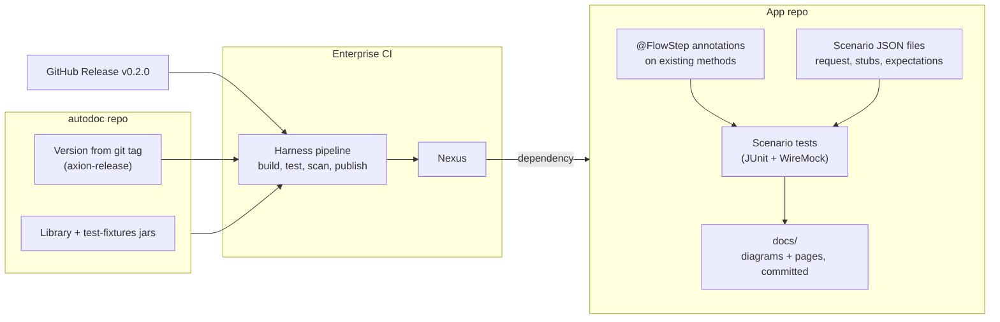
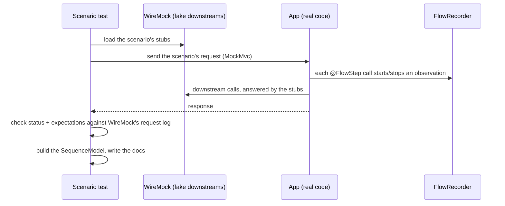
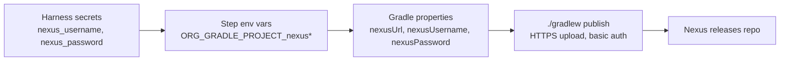
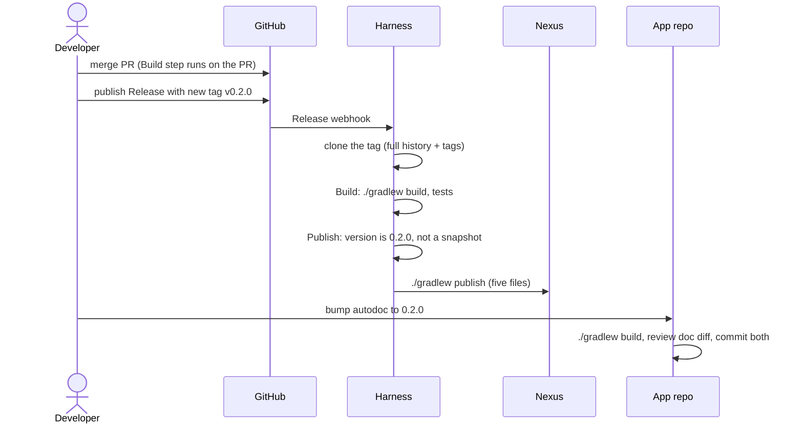

# autodoc: how it fits together

A one-page reference to the whole approach: what each piece does, how it works, and how the
pieces connect, from an annotation in an app to a versioned library in Nexus. `README.md` has the
full setup steps.

## The idea in one paragraph

autodoc turns a Spring Boot app's tests into living flow documentation. Developers mark the
methods that matter with `@FlowStep`, and describe business scenarios as JSON files: the request,
what downstream systems answer, and what the app is expected to do. The tests run every scenario
through the real app, check the expectations, and write a sequence diagram and a readable page
per scenario. The docs are committed next to the code, and CI fails if anyone changes behavior
without regenerating them, so the docs can't drift from what the code actually does.

## The big picture



There are two halves:

1. **Inside an app:** annotations plus scenarios produce docs, during the app's normal test run.
2. **The library itself:** built, versioned and published to Nexus by CI, so apps can depend on it.

---

## Part 1: Inside an app

### What the app gains

| Piece | Where | Purpose |
| --- | --- | --- |
| `@FlowStep(action, participant, note)` | on existing methods: controller, orchestration, downstream calls, exception handlers | Marks a step in the flow. Method bodies don't change. |
| `@FlowParticipant` constants | `Participants.java` | The systems drawn in the diagrams, with display labels |
| Step action constants | `Steps.java` | Each step's name, defined once |
| Scenario files | `src/test/resources/scenarios/*.json` | One business case each: request, stubs, expectations |
| Glossary (optional) | `autodoc-glossary.json` | Business labels for endpoints and fields |
| A handful of test classes | `src/test/java/.../docs/` | Run the scenarios, check the rules, write the docs |
| Generated docs | `docs/` | Committed with the code |

**Add-only:** the app gains annotations and test code. Its functional code never changes for
autodoc.

### Off in production, on in tests

- `@FlowStep` is plain metadata until `autodoc.observations.enabled=true`.
- When it's off, which is the default and always the case in production, `AutodocAutoConfiguration`
  registers nothing: no beans, no proxies, no expression parsing. Performance is unaffected.
- The scenario tests switch it on. Each `@FlowStep` call is then wrapped by `FlowStepInterceptor`,
  which records it as a Micrometer observation (Spring Boot's standard instrumentation API),
  tagged with the step's action and participant.

### What happens when one scenario runs



1. **Stubs load.** The scenario's stubs are standard WireMock mappings. WireMock stands in for every
   downstream system, so the run needs no real partners and no network.
2. **The request runs through the real app** via MockMvc (Spring's in-process HTTP test client).
3. **Steps are recorded.** `FlowRecorder` builds a tree of the steps as their observations start and
   stop, which gives nesting and order.
4. **Expectations are checked.** They're written in WireMock's own request-matching syntax:
   "this endpoint is called once with SKU = SKU-1001", "backorder is not called". WireMock's own
   matchers check them against every request the app actually made. All failures are reported
   together, with WireMock's diff against the closest request.
5. **Docs are written.** The step tree becomes one `SequenceModel`, drawn twice: as Mermaid
   (`MermaidSequence`) and as SVG (`SvgSequence`). The page lists the expected behavior as plain
   sentences, followed by the request, the diagram, each downstream call and the response.

A separate test builds the **static graph** of every step from the compiled classes (`FlowGraph`,
using ArchUnit), plus an index page.

### The output

For each scenario under `docs/`:

- `flows/<name>.md`: the page, with a Mermaid diagram (renders on GitHub, GitLab, etc.)
- `flows/<name>.mmd`: the raw Mermaid diagram
- `markdown-image/flows/<name>.md` + `.svg`: a self-contained copy with SVG images, for tools
  that can't render Mermaid, such as Confluence without a plugin

Plus `README.md` and `flow.mmd`/`flow.svg` for the static graph.

### Why the docs can't drift

- **Deterministic output.** Every doc is byte-identical across runs and machines: no timestamps,
  sorted output, and SVG text sized by character count rather than font measurement.
- **Verify mode.** CI runs `./gradlew build -Pautodoc.docs.verify=true`. It writes nothing, and fails
  if any committed doc differs from what the code now produces, or if a scenario has no page.
- **Rules as tests.** `AutodocRules` (ArchUnit) fails the build if a step can't be recorded (for
  example, a `private` method), if two steps share an action, if a participant is undeclared, if a
  note doesn't parse, or if a method calling `RestClient`/`RestTemplate`/`WebClient` isn't a step.

The developer loop: change code → `./gradlew build` regenerates the docs → review the doc diff in
the PR → commit both.

### Optional: load testing

`templates/gatling/` replays the same scenarios as a Gatling load test against the running app,
with WireMock serving the stubs. Per-step timings come from the same observations, at
`/actuator/metrics/autodoc.step`.

### Limits

- Spring MVC only. WebFlux isn't supported.
- Spring proxies only see calls between beans, so calls within one class and
  `private`/`final`/`static` methods aren't recorded. The rules catch the latter.

---

## Part 2: Building, versioning and publishing the library

### What gets published

`com.example:autodoc:<version>`, as five files:

| File | Used for |
| --- | --- |
| `autodoc-<v>.jar` | the app's main classpath: annotations and the inert auto-configuration |
| `autodoc-<v>-test-fixtures.jar` | the app's test classpath only: runner, renderers, rules. WireMock, ArchUnit and JUnit never reach production. |
| `-sources.jar` | IDE source view |
| `.pom` | Maven metadata |
| `.module` | Gradle metadata. Required: it's what makes `testFixtures('com.example:autodoc:<v>')` work. |

`scripts/change-group.sh` swaps `com.example` for the enterprise's own group and packages.

### Versions come from git tags

The axion-release Gradle plugin derives the version from git. There's no version number in any
file.

| Commit | Version |
| --- | --- |
| tagged `v0.2.0` | `0.2.0` |
| any other commit, or uncommitted changes | next snapshot, e.g. `0.2.1-SNAPSHOT` |

`./gradlew currentVersion` prints it. Since the tag is the only place a version lives, a tag and a
version file can never disagree.

Settings in `build.gradle`, and why:

```groovy
scmVersion {                       // must come before the version is first read
    versionCreator('simple')       // plain 0.2.1-SNAPSHOT on every branch, no branch name
    unshallowRepoOnCI = false      // its CI git fetch has no credentials in a build container
}
version = scmVersion.version
```

### Credentials and the Nexus URL

`build.gradle` declares one Maven repository named `nexus`. Gradle reads its URL and credentials
from three properties: `nexusUrl`, `nexusUsername`, `nexusPassword`.



- Gradle turns any `ORG_GRADLE_PROJECT_<name>` environment variable into the property `<name>`.
- Secrets never appear in the repo, and Harness masks them in logs.
- Only `publish` needs them. `build` and `publishToMavenLocal` work without them.
- To publish from a laptop, put the three properties in `~/.gradle/gradle.properties`, never in the
  repo.

### The Harness pipeline

`templates/harness/autodoc-publish.yaml`, one CI stage with two steps:

| Step | Runs | Does |
| --- | --- | --- |
| **Build** | every run (PRs, branches, releases) | `./gradlew build`: compile, test, jars. Test results appear in the run's **Tests** tab. |
| **Publish** | only for a published GitHub Release | checks the version, then `./gradlew publish` to Nexus |

How the pieces work:

- **Image:** `eclipse-temurin:21-jdk`, a plain JDK. The repo's `./gradlew` wrapper downloads the
  right Gradle version itself.
- **Workspace:** Harness clones the repo once into a shared folder, mounted into each step's
  container. Both steps keep Gradle's cache there (`GRADLE_USER_HOME="$PWD/.gradle"`), so Publish
  reuses Build's downloads.
- **Clone:** `build: type: branch` with `<+pipeline.branch>`, the branch (or tag) the pipeline file
  was loaded from. `depth: 0` fetches full history, and `fetchTags: true` fetches the tags. Without
  tags, axion-release can't see the release and reports `0.1.0-SNAPSHOT`.
- **Release trigger:** a GitHub **Release** event with the **publish** action. Its Pipeline Reference
  Branch is `<+"$tag:"+<+trigger.payload.release.tag_name>>`, so the pipeline, and therefore the
  code, comes from the release's tag.
- **Publish gate:** the step's condition is `"<+trigger.payload.release.tag_name>".startsWith("v")`,
  so it only runs for releases. As a second check, it fails loudly if the checked-out code still
  builds as a `-SNAPSHOT` version, because that means the tag wasn't checked out.
- **Security scan:** the enterprise pipeline adds SonarQube vulnerability checks.

### Releasing, end to end



- Each release needs a new tag: Nexus rejects a second upload of the same release version.
- Version bumps follow semantic versioning. A change to annotations, to expectation syntax, or to
  how docs render is a major change, since apps that verify their docs must regenerate them.

---

## Lessons from the first enterprise runs

| Symptom | Cause | Fix |
| --- | --- | --- |
| `Unshallowing repo...` then `TransportException: not authorized` | axion-release fetches from git on CI, and build containers have no git credentials | `unshallowRepoOnCI = false`, placed before `version = scmVersion.version` |
| Release run builds as `0.1.0-SNAPSHOT` | the clone had no tags | `fetchTags: true` in the codebase settings |
| Publish never ran on a tag build | a tag-push trigger reports build type `Push`, not `tag` | gate on the Release payload instead |
| A PR run used the previous pipeline YAML | the pipeline file is fetched separately from the code clone, and can briefly see the old commit right after a push | rerun; compare with **View Compiled YAML** |
| SonarQube: "Disable access to external entities in XML parsing" | a test parsed SVG with the default XML parser | turn off external DTD and schema access |

## Glossary

| Term | Meaning |
| --- | --- |
| Step | One `@FlowStep` method call, drawn as an arrow or self-message |
| Participant | A system in the diagram, such as the app or a downstream service |
| Scenario | One JSON-defined business case: request, stubs, expectations |
| Stub | A canned downstream response, in WireMock's mapping format |
| Expectation | A WireMock request pattern the app's downstream calls must (or must not) match |
| Observation | Micrometer's unit of instrumentation, used here to record each step |
| Snapshot | A non-release version (`-SNAPSHOT`), never published by the pipeline |
| Release | A GitHub Release with a `v*` tag, which triggers the publish |
